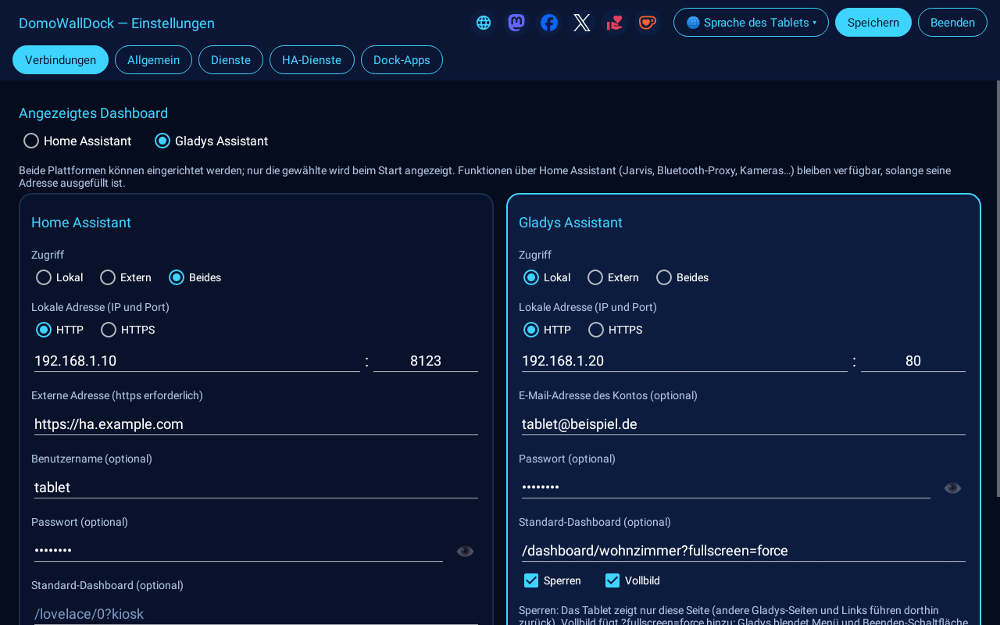
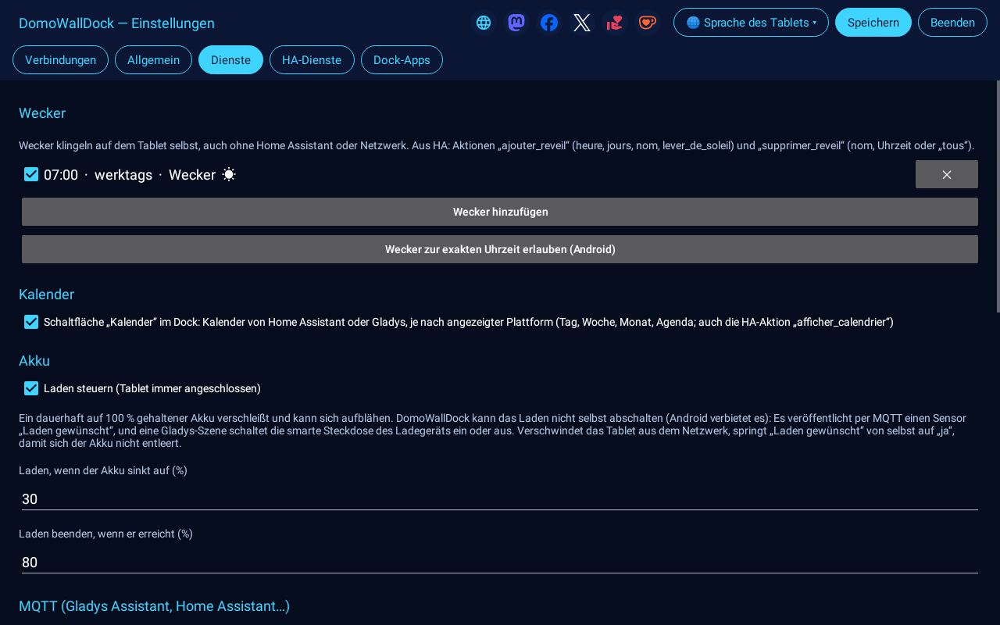

# DomoWallDock

  &nbsp;
  &nbsp;
  &nbsp;
  

**Mach aus einem Android-Tablet ein Wand-Dashboard für [Home Assistant](https://www.home-assistant.io/) oder [Gladys Assistant](https://gladysassistant.com/).**

DomoWallDock (früher GladysWallDock) ist ein Fork von [WallDock](https://github.com/psycho1807/WallDock) von psycho1807. WallDock ist für Home Assistant gedacht; alles, was es kann, ist hier weiterhin vorhanden, und Gladys Assistant kommt hinzu. Lizenz GPL-3.0 wie das Original.

> 📘 **Bebilderte Anleitung: [DomoWallDock mit Gladys Assistant nutzen](docs/TUTO-GLADYS.de.md)** — Installation, Verbindung, MQTT, Ladesteuerung, Bildschirmschoner.
> Die App gibt es auf Französisch, Englisch, Deutsch und Spanisch: standardmäßig in der Sprache des Tablets oder nach Wahl in den Einstellungen.

## Vorschau

  
  

  

## Download

Die signierten APKs liegen unter [**Releases**](https://github.com/McFlyPartages/DomoWallDock/releases) (nimm die neueste; es sind Vorabversionen).

| Dein Tablet | Herunterzuladende Datei | Branch |
|---|---|---|
| **Android 8 oder neuer** (Normalfall) | `DomoWallDock-x.y.z.apk` | `main` |
| **Android 7.x** (ältere Tablets) | `DomoWallDock-x.y.z-android7.apk` | `android7` |

- Die Version `android7` ist ein **eingefrorener** Branch: Sie erhält nur Korrekturen, die von Hand übertragen werden. Unter Android 8+ immer die Standardversion verwenden.
- Beide Versionen sind mit **demselben Schlüssel** signiert: Eine neue Version wird über die alte installiert, die Einstellungen bleiben erhalten.
- Installation: „Unbekannte Quellen“ für den verwendeten Browser oder Dateimanager erlauben, die Datei öffnen und dann [Installation](#installation) folgen.

## Kompatibilität Home Assistant / Gladys Assistant

| Funktion | Home Assistant | Gladys Assistant |
|---|:---:|:---:|
| Vollbild-Dashboard, Kiosk-Modus, App-Dock, automatische Rückkehr | ✅ | ✅ |
| Automatische Anmeldung (Benutzer und Passwort) | ✅ ¹ | ✅ |
| Zugriff lokal, extern oder beides (automatischer Wechsel) | ✅ | ✅ |
| Bildschirmschoner: Uhr, Immich-Album, Fotoordner, Seite der Plattform | ✅ | ✅ |
| Bildschirm nachts aus, Einschalten per Frontkamera | ✅ | ✅ |
| Vollbild-Kalender (Tag, Woche, Monat, Agenda) | ✅ | ✅ |
| Wecker auf dem Tablet | ✅ (auch aus HA steuerbar) | ✅ (in der App eingestellt) |
| Tablet-Sensoren: Akku, Laden, Bewegung, Bildschirm | ✅ (ESPHome oder MQTT) | ✅ (MQTT) |
| Ladesteuerung mit smarter Steckdose | ✅ (MQTT + Automatisierung) | ✅ (MQTT + Szenen) |
| Synchroner Music-Assistant-Player (Sendspin) | ✅ | ✅ ² |
| Volle Steuerung aus der Plattform (Helligkeit, App oder Seite öffnen, Hinweise, Kameras im Vollbild, Töne, Sprachausgabe…) | ✅ (ESPHome) | ➖ Bildschirm, neu laden, zurück zum Dashboard |
| Sprachassistent Jarvis („Hey Jarvis“) | ✅ | ❌ |
| ESPHome-Bluetooth-Proxy | ✅ | ❌ |

¹ Nicht mit Zwei-Faktor-Authentifizierung. ² Music Assistant ist ein eigener Server: Er funktioniert mit oder ohne Home Assistant.
Wählst du Gladys, wählt die App Jarvis, den Bluetooth-Proxy und Music Assistant selbst ab (du kannst sie wieder anwählen, etwa wenn du auch Home Assistant oder einen Music-Assistant-Server nutzt).

## Was DomoWallDock kann

**Home Assistant oder Gladys, nach Wahl**
- Einstellungen → Tab **Verbindungen** → „Angezeigtes Dashboard“: Ein Optionsfeld wählt die gestartete Plattform. Jede hat ihre Spalte (nebeneinander auf einem breiten Bildschirm oder einem Tablet im Querformat, sonst untereinander): Adresse, Konto, Passwort und Standard-Dashboard (optional, z. B. `/lovelace/0?kiosk` oder `/dashboard/wohnzimmer`). Bei Gladys beschränkt das Kästchen **Sperren** die Anzeige auf diese Seite (andere Gladys-Seiten und Links führen dorthin zurück), und das Kästchen **Vollbild** fügt `?fullscreen=force` hinzu (oder `&fullscreen=force`, wenn die Adresse schon einen Parameter hat): Gladys öffnet im Vollbild, ohne Menü und ohne Schaltfläche zum Beenden.
- **Zugriff Lokal / Extern / Beides** für jede Plattform: lokale Adresse (HTTP oder HTTPS, IP und Port) und externe Adresse (HTTPS). Mit „Beides“ nimmt die App die lokale Adresse, wenn sie antwortet, sonst die externe: Das Tablet funktioniert auch unterwegs, etwa hinter einem Reverse Proxy. Eine Zustandsprüfung testet jede Adresse.
- **Automatische Anmeldung**: Mit Benutzer und Passwort meldet sich das Tablet selbst an, wenn die Anmeldeseite erscheint (Home Assistant: wie „Angemeldet bleiben“; nicht mit Zwei-Faktor-Authentifizierung). Tipp: ein eigenes Konto für das Tablet, ohne Administratorrechte.
- Funktionen über Home Assistant (Jarvis, Bluetooth-Proxy, Kameras, Töne) bleiben verfügbar, wenn Gladys angezeigt wird, solange die HA-Adresse ausgefüllt ist.

**ESPHome-Bluetooth-Proxy** (Home Assistant)
- Einstellungen → „Bluetooth-Proxy (ESPHome)“: Das Tablet hört die Bluetooth-Low-Energy-Geräte in seiner Umgebung ab (Xiaomi-Thermometer, BTHome-Sensoren, Beacons…) und leitet ihre Meldungen über die ESPHome-Integration an Home Assistant weiter, genau wie ein ESPHome-Modul `bluetooth_proxy`. Die Geräte erscheinen in HA, als wären sie in Reichweite seines eigenen Bluetooth.
- Nur Zuhören: HA kann sich über das Tablet nicht mit Geräten *verbinden* (Geräte mit GATT-Verbindung, Kopplung).
- Bluetooth- und Standortberechtigung werden beim Speichern abgefragt (ohne Standort blendet Android Beacons aus). Die Suche läuft nur, solange HA abonniert ist.
- Gladys kann keinen Bluetooth-Proxy nutzen: Diese Option hilft nur mit Home Assistant.

**Mit Gladys Assistant**
- **MQTT-Verbindung** (für beide Plattformen): Einstellungen → „MQTT“, mit Broker-Adresse, Benutzer und Passwort (in Gladys: Integrationen → MQTT → Konfiguration). Das Tablet meldet sich selbst an (MQTT-Discovery-Format von Home Assistant, das neuere Gladys-5-Versionen verstehen): Integrationen → MQTT → erkannte Geräte, „DomoWallDock …“ hinzufügen.
- In Gladys: Akku, Akkutemperatur, Laden, Bewegung, Bildschirm (an / aus), Tasten „Neu laden“ und „Zurück zum Dashboard“.
- **Ladesteuerung** für ein dauerhaft angeschlossenes Tablet: Einstellungen → „Akku“. Android erlaubt einer App nicht, das Laden abzuschalten; DomoWallDock veröffentlicht daher einen Sensor „Laden gewünscht“ (ja unter der unteren Schwelle, standardmäßig 30 %; nein über der oberen Schwelle, standardmäßig 80 %), und zwei Gladys-Szenen steuern die smarte Steckdose des Ladegeräts:
  - „Laden gewünscht“ wechselt auf 1 → Steckdose einschalten;
  - „Laden gewünscht“ wechselt auf 0 → Steckdose ausschalten.

  Verschwindet das Tablet aus dem Netzwerk (Absturz, WLAN weg), setzt der Broker „Laden gewünscht“ von selbst auf ja (MQTT Last Will), damit sich der Akku nicht entleert.
- **Bildschirm über die Frontkamera gesteuert**: Der Bildschirm geht an, wenn jemand vorbeigeht, und nach einer Wartezeit ohne Bewegung oder Berührung aus (Einstellungen → Bewegungserkennung → Wartezeit in Sekunden). Die Bilder werden auf dem Tablet ausgewertet und nie gesendet oder gespeichert.

**Kiosk** (von WallDock übernommen)
- Vollbild, ausgeblendete Systemleisten, Bildschirm immer an, Einstellungen per Code geschützt.
- Einstellungen in fünf Tabs (**Verbindungen**, **Allgemein**, **Dienste**, **HA-Dienste**, **Dock-Apps**); obere Leiste mit der Sprache der App, **Speichern** (ohne zu verlassen) und **Beenden** (ohne zu speichern).
- Dock erlaubter Apps (die Jarvis-Taste erscheint nur, wenn Jarvis aktiviert ist), automatische Rückkehr zum Dashboard nach Inaktivität.
- Kann der Startbildschirm des Tablets werden; startet beim Hochfahren neu (Stromausfall).
- Dashboard-Zoom (50 bis 200 %), Bildschirmschoner (Uhr, beliebige Seite, Immich-Diashow oder Fotoordner).
- Zeitplan: Bildschirm jede Nacht aus. Liste erlaubter Adressen. Notfallbildschirm, wenn der Server nicht antwortet.
- Sicherung und Wiederherstellung der Einstellungen in einer Datei (WallDock-Sicherungen werden akzeptiert).

**Mit Home Assistant** (von WallDock übernommen, weiterhin funktionsfähig)
- Verschlüsselte native ESPHome-Integration, Sprachassistent Jarvis, Mediaplayer, synchroner Music-Assistant-Player (Sendspin), Wecker, Kalender. Diese Funktionen brauchen Home Assistant; wählst du Gladys, werden Jarvis, der Bluetooth-Proxy und Music Assistant automatisch abgewählt (du kannst sie wieder anwählen).

## MQTT-Topics

`<gerät>` ist `domowalldock-xxxxxx` (in den Einstellungen angezeigt).

| Topic | Richtung | Werte |
|---|---|---|
| `domowalldock/<gerät>/battery` | Zustand | 0 bis 100 |
| `domowalldock/<gerät>/battery_temperature` | Zustand | °C |
| `domowalldock/<gerät>/charging` | Zustand | `ON` / `OFF` |
| `domowalldock/<gerät>/charge_wanted` | Zustand | `ON` / `OFF` (wenn die Ladesteuerung aktiv ist) |
| `domowalldock/<gerät>/motion` | Zustand | `ON` / `OFF` |
| `domowalldock/<gerät>/screen` | Zustand | `ON` / `OFF` |
| `domowalldock/<gerät>/screen/set` | Befehl | `ON` / `OFF` |
| `domowalldock/<gerät>/reload/set` | Befehl | beliebiger Wert |
| `domowalldock/<gerät>/dashboard/set` | Befehl | beliebiger Wert |

## Installation

1. Das passende APK für dein Tablet herunterladen (siehe [Download](#download)) und installieren (Installation aus dieser Quelle erlauben). Die App hat eine eigene Kennung (`fr.mcflypartages.domowalldock`): Sie kann neben WallDock bestehen.
2. Beim ersten Start: Plattform (Home Assistant oder Gladys), ihre Adresse (und bei Bedarf Konto, Passwort, Dashboard), Admin-Code (Tab Allgemein), Dock-Apps (Tab Dock-Apps), dann **Speichern**.
3. In den Einstellungen: Startbildschirm, Einblenden über anderen Apps, Kamera (Bewegungserkennung), dann den Tab Dienste → MQTT.
4. Die Akku-Optimierung von Android für DomoWallDock abschalten, sonst kann das System die App beenden ([dontkillmyapp.com](https://dontkillmyapp.com) beschreibt jede Marke).

**Updates**: von Hand, indem das neue APK über das alte installiert wird (gleicher Signaturschlüssel, Einstellungen bleiben erhalten). Die App aktualisiert sich nicht selbst.

## Kompilieren

`gradle assembleGithubRelease` mit Gradle 8.14, JDK 17 und Android-SDK 36. Zum Signieren den Pfad des Schlüsselspeichers (PKCS12, Alias `gladyswalldock`, ursprünglicher Name des Schlüssels) in `WALLDOCK_KEYSTORE` und sein Passwort in `WALLDOCK_KEY_PASSWORD` angeben; der Schlüssel ist nicht im Repository. Ohne sie ist das APK nicht signiert (`assembleGithubDebug` liefert ein Test-APK).

Der Code behält das ursprüngliche Paket `app.walldock`, um Änderungen des Originals leicht übernehmen zu können. Der MQTT-Client (`app/src/main/java/app/walldock/mqtt`) und der ESPHome-Server (`…/esphome`) sind reines Java und lassen sich auf einer JVM testen. `./gradlew testGithubDebugUnitTest` zeichnet den Einstellungsbildschirm als PNG (Robolectric) in `app/build/preview`.

## Quellcode und Repositories

Die Entwicklung findet auf einem privaten Forgejo statt; dieses GitHub-Repository ist ein **Spiegel** (Branches `main` und `android7` sowie die Tags). Die Release-APKs werden auf beiden Seiten veröffentlicht. Änderungen laufen über Pull Requests auf der Ursprungs-Forge und kommen dann hier an.

## Danksagungen

- **DomoWallDock**: angepasst und gepflegt von **McFlyPartages**.

       

  Gefällt dir die App? Eine kleine Unterstützung über Tipeee oder Ko-fi freut immer.

- **[WallDock](https://github.com/psycho1807/WallDock)** von psycho1807 (GPL-3.0): die gesamte Basis der App. DomoWallDock ist weder mit seinem Autor verbunden noch von ihm unterstützt; WallDock Pro ist ein eigenes Produkt.
- Wort „Stop“: Modell [microWakeWord](https://github.com/kahrendt/microWakeWord) von Kevin Ahrendt (Apache 2.0); Merkmalsextraktion portiert aus dem Micro-Frontend von TensorFlow Lite Micro (Apache 2.0).
- Aktivierungswort: Modelle [openWakeWord](https://github.com/dscripka/openWakeWord) (beim ersten Gebrauch heruntergeladen, CC BY-NC-SA 4.0), ausgeführt mit TensorFlow Lite.
- Protokolle: [native ESPHome-API](https://esphome.io/components/api.html), MQTT-Discovery von Home Assistant.
- Symbole: [Simple Icons](https://simpleicons.org/) (CC0), [Material Design Icons](https://pictogrammers.com/library/mdi/) (Apache 2.0), [flag-icons](https://github.com/lipis/flag-icons) (MIT).
