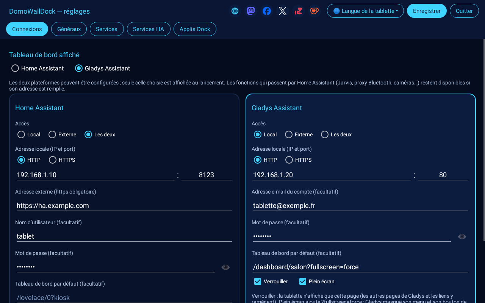
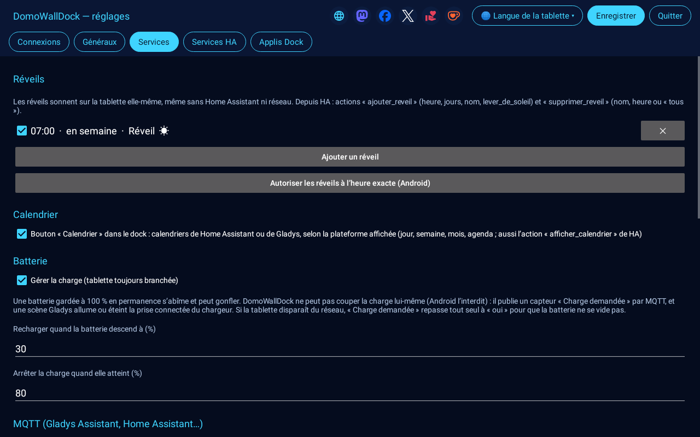

# DomoWallDock

  &nbsp;
  &nbsp;
  &nbsp;
  

**Transformez une tablette Android en tableau de bord mural pour [Home Assistant](https://www.home-assistant.io/) ou [Gladys Assistant](https://gladysassistant.com/).**

DomoWallDock (anciennement GladysWallDock) est un dérivé (*fork*) de [WallDock](https://github.com/psycho1807/WallDock), de psycho1807. WallDock est pensé pour Home Assistant ; tout ce qu'il sait faire reste présent ici, et Gladys Assistant s'y ajoute. Licence GPL-3.0, comme l'original.

> 📘 **Tutoriel illustré : [utiliser DomoWallDock avec Gladys Assistant](docs/TUTO-GLADYS.md)** — installation, connexion, MQTT, gestion de la charge, écran de veille.
> L'appli est en français, anglais, allemand et espagnol : langue de la tablette par défaut, ou au choix dans les réglages.

## Aperçu

  
  

  

## Téléchargement

Les APK signés sont dans les [**Releases**](https://github.com/McFlyPartages/DomoWallDock/releases) (prenez la plus récente ; ce sont des pré-versions).

| Votre tablette | Fichier à télécharger | Branche |
|---|---|---|
| **Android 8 ou plus récent** (cas général) | `DomoWallDock-x.y.z.apk` | `main` |
| **Android 7.x** (tablettes anciennes) | `DomoWallDock-x.y.z-android7.apk` | `android7` |

- La version `android7` est une branche **figée** : elle ne reçoit que les corrections, reportées à la main. Sur Android 8+, utilisez toujours la version standard.
- Les deux versions sont signées avec la **même clé** : on peut installer une nouvelle version par-dessus l'ancienne, les réglages sont conservés.
- Pour les installer : autoriser « sources inconnues » pour le navigateur ou le gestionnaire de fichiers utilisé, ouvrir le fichier, puis suivre [Installation](#installation).

## Compatibilité Home Assistant / Gladys Assistant

| Fonction | Home Assistant | Gladys Assistant |
|---|:---:|:---:|
| Tableau de bord en plein écran, mode kiosque, dock d'applis, retour automatique | ✅ | ✅ |
| Connexion automatique (compte et mot de passe) | ✅ ¹ | ✅ |
| Accès local, externe ou les deux (bascule automatique) | ✅ | ✅ |
| Écran de veille : horloge, album Immich, dossier de photos, page de la plateforme | ✅ | ✅ |
| Écran éteint chaque nuit, allumage par la caméra frontale | ✅ | ✅ |
| Calendrier plein écran (jour, semaine, mois, agenda) | ✅ | ✅ |
| Réveils sur la tablette | ✅ (aussi pilotables depuis HA) | ✅ (réglés dans l'appli) |
| Capteurs de la tablette : batterie, charge, mouvement, écran | ✅ (ESPHome ou MQTT) | ✅ (MQTT) |
| Gestion de la charge avec une prise connectée | ✅ (MQTT + automatisation) | ✅ (MQTT + scènes) |
| Lecteur Music Assistant synchronisé (Sendspin) | ✅ | ✅ ² |
| Pilotage complet depuis la plateforme (luminosité, ouvrir une appli ou une page, alertes, caméras plein écran, sons, synthèse vocale…) | ✅ (ESPHome) | ➖ écran, recharger, retour au tableau de bord |
| Assistant vocal Jarvis (« Hey Jarvis ») | ✅ | ❌ |
| Proxy Bluetooth ESPHome | ✅ | ❌ |

¹ Pas avec l'authentification à deux facteurs. ² Music Assistant est un serveur à part : il fonctionne avec ou sans Home Assistant.
Quand vous choisissez Gladys, l'appli décoche d'elle-même Jarvis, le proxy Bluetooth et Music Assistant (vous pouvez les recocher, par exemple si vous utilisez aussi Home Assistant ou un serveur Music Assistant).

## Ce que fait DomoWallDock

**Home Assistant ou Gladys, au choix**
- Réglages → onglet **Connexions** → « Tableau de bord affiché » : un bouton radio choisit la plateforme lancée. Chacune a sa colonne (côte à côte sur un écran large ou une tablette en paysage, l'une sous l'autre sinon) : adresse, compte, mot de passe et tableau de bord par défaut (facultatif, ex. `/lovelace/0?kiosk` ou `/dashboard/salon`). Côté Gladys, la case **Verrouiller** limite l'affichage à cette page (les autres pages de Gladys et les liens y ramènent) et la case **Plein écran** ajoute `?fullscreen=force` (ou `&fullscreen=force` si l'adresse a déjà un paramètre) : Gladys s'ouvre en plein écran, sans menu ni bouton pour en sortir.
- **Accès Local / Externe / Les deux** pour chaque plateforme : adresse locale (HTTP ou HTTPS, IP et port) et adresse externe (HTTPS). Avec « Les deux », l'appli prend l'adresse locale si elle répond, sinon l'externe : la tablette fonctionne aussi hors de chez vous, par exemple derrière un reverse proxy. Un contrôle de santé vérifie chaque adresse.
- **Connexion automatique** : avec un compte et un mot de passe, la tablette se connecte toute seule quand la page de connexion s'affiche (Home Assistant : comme « Rester connecté » ; pas avec l'authentification à deux facteurs). Conseil : un compte dédié à la tablette, sans droits d'administration.
- Les fonctions qui passent par Home Assistant (Jarvis, proxy Bluetooth, caméras, sons) restent disponibles quand Gladys est affiché, tant que l'adresse de HA est remplie.

**Proxy Bluetooth ESPHome** (Home Assistant)
- Réglages → « Proxy Bluetooth (ESPHome) » : la tablette écoute les appareils Bluetooth Low Energy autour d'elle (thermomètres Xiaomi, capteurs BTHome, balises…) et transmet leurs annonces à Home Assistant par l'intégration ESPHome, exactement comme un module ESPHome `bluetooth_proxy`. Les appareils apparaissent dans HA comme s'ils étaient à portée de son propre Bluetooth.
- Écoute seule : HA ne peut pas se *connecter* aux appareils à travers la tablette (appareils qui demandent une connexion GATT, appairage).
- Autorisations Bluetooth et position demandées à l'enregistrement (sans la position, Android masque les balises). L'écoute ne tourne que lorsque HA est abonné.
- Gladys ne sait pas utiliser un proxy Bluetooth : l'option ne sert qu'avec Home Assistant.

**Avec Gladys Assistant**
- **Connexion par MQTT** (commun aux deux plateformes) : réglages → « MQTT », avec l'adresse du broker, l'utilisateur et le mot de passe (dans Gladys : Intégrations → MQTT → Configuration). La tablette s'annonce toute seule (format de découverte MQTT de Home Assistant, compris par les versions récentes de Gladys 5) : Intégrations → MQTT → appareils découverts, ajouter « DomoWallDock … ».
- Dans Gladys : batterie, température de la batterie, en charge, mouvement, écran (allumer / éteindre), boutons « Recharger » et « Retour au tableau de bord ».
- **Gestion de la charge** pour une tablette toujours branchée : réglages → « Batterie ». Android n'autorise pas une appli à couper la charge ; DomoWallDock publie donc un capteur « Charge demandée » (oui sous le seuil bas, 30 % par défaut ; non au-dessus du seuil haut, 80 % par défaut) et deux scènes Gladys pilotent la prise connectée du chargeur :
  - « Charge demandée » passe à 1 → allumer la prise ;
  - « Charge demandée » passe à 0 → éteindre la prise.

  Si la tablette disparaît du réseau (plantage, Wi-Fi coupé), le broker remet tout seul « Charge demandée » à oui (testament MQTT), pour que la batterie ne se vide pas.
- **Écran piloté par la caméra frontale** : l'écran s'allume quand quelqu'un passe et s'éteint après un délai sans mouvement ni toucher (réglages → détection de mouvement → délai en secondes). Les images sont analysées sur la tablette et ne sont jamais envoyées ni enregistrées.

**Kiosque** (hérité de WallDock)
- Plein écran, barres système masquées, écran toujours allumé, réglages protégés par un code.
- Réglages en cinq onglets (**Connexions**, **Généraux**, **Services**, **Services HA**, **Applis Dock**) ; barre du haut avec la langue de l'appli, **Enregistrer** (sans quitter) et **Quitter** (sans enregistrer).
- Dock d'applis autorisées (le bouton Jarvis n'y apparaît que si Jarvis est activé), retour automatique au tableau de bord après inactivité.
- Peut devenir l'écran d'accueil de la tablette ; se relance au démarrage (coupure de courant).
- Zoom du tableau de bord (50 à 200 %), écran de veille (horloge, page au choix, diaporama Immich ou dossier de photos).
- Planification : écran éteint chaque nuit. Liste blanche d'adresses. Écran de secours quand le serveur ne répond pas.
- Sauvegarde et restauration des réglages dans un fichier (les sauvegardes de WallDock sont acceptées).

**Avec Home Assistant** (hérité de WallDock, toujours fonctionnel)
- Intégration native ESPHome chiffrée, assistant vocal Jarvis, lecteur multimédia, lecteur Music Assistant synchronisé (Sendspin), réveils, calendrier. Ces fonctions ont besoin de Home Assistant ; quand on choisit Gladys, Jarvis, le proxy Bluetooth et Music Assistant sont décochés automatiquement (on peut les recocher).

## Sujets MQTT

`<appareil>` vaut `domowalldock-xxxxxx` (affiché dans les réglages).

| Sujet | Sens | Valeurs |
|---|---|---|
| `domowalldock/<appareil>/battery` | état | 0 à 100 |
| `domowalldock/<appareil>/battery_temperature` | état | °C |
| `domowalldock/<appareil>/charging` | état | `ON` / `OFF` |
| `domowalldock/<appareil>/charge_wanted` | état | `ON` / `OFF` (si la gestion de la charge est activée) |
| `domowalldock/<appareil>/motion` | état | `ON` / `OFF` |
| `domowalldock/<appareil>/screen` | état | `ON` / `OFF` |
| `domowalldock/<appareil>/screen/set` | commande | `ON` / `OFF` |
| `domowalldock/<appareil>/reload/set` | commande | n'importe quelle valeur |
| `domowalldock/<appareil>/dashboard/set` | commande | n'importe quelle valeur |

## Installation

1. Télécharger l'APK adapté à votre tablette (voir [Téléchargement](#téléchargement)) et l'installer (autoriser l'installation depuis cette source). L'appli a son propre identifiant (`fr.mcflypartages.domowalldock`) : elle peut cohabiter avec WallDock.
2. Au premier lancement : plateforme (Home Assistant ou Gladys), son adresse (et si besoin compte, mot de passe, tableau de bord), code administrateur (onglet Généraux), applis du dock (onglet Applis Dock), puis **Enregistrer**.
3. Dans les réglages : écran d'accueil, affichage par-dessus les autres applis, caméra (détection de mouvement), puis l'onglet Services → MQTT.
4. Désactiver l'optimisation de batterie d'Android pour DomoWallDock, sinon le système peut couper l'appli ([dontkillmyapp.com](https://dontkillmyapp.com) détaille chaque marque).

**Mises à jour** : à la main, en installant le nouvel APK par-dessus l'ancien (même clé de signature, les réglages sont conservés). L'appli ne se met pas à jour toute seule.

## Compilation

`gradle assembleGithubRelease` avec Gradle 8.14, JDK 17 et le SDK Android 36. Pour signer, donner le chemin du magasin de clés (PKCS12, alias `gladyswalldock`, nom d'origine de la clé) dans `WALLDOCK_KEYSTORE` et son mot de passe dans `WALLDOCK_KEY_PASSWORD` ; la clé n'est pas dans le dépôt. Sans elles, l'APK n'est pas signé (`assembleGithubDebug` donne un APK de test).

Le code garde le paquet `app.walldock` de l'original, pour reprendre facilement ses évolutions. Le client MQTT (`app/src/main/java/app/walldock/mqtt`) et le serveur ESPHome (`…/esphome`) sont en Java pur et se testent sur une JVM. `./gradlew testGithubDebugUnitTest` dessine l'écran des réglages en PNG (Robolectric) dans `app/build/preview`.

## Code source et dépôts

Le développement a lieu sur un Forgejo personnel ; ce dépôt GitHub en est une **copie miroir** (branches `main` et `android7`, et les tags). Les APK des Releases sont publiés des deux côtés. Les évolutions passent par des *pull requests* sur la forge d'origine, puis arrivent ici.

## Crédits

- **DomoWallDock** : adapté et maintenu par **McFlyPartages**.

       

  Vous aimez l'appli ? Un petit soutien sur Tipeee ou Ko-fi fait toujours plaisir.

- **[WallDock](https://github.com/psycho1807/WallDock)** de psycho1807 (GPL-3.0) : toute la base de l'appli. DomoWallDock n'est ni affilié à son auteur ni soutenu par lui ; WallDock Pro est un produit distinct.
- Mot « Stop » : modèle [microWakeWord](https://github.com/kahrendt/microWakeWord) de Kevin Ahrendt (Apache 2.0) ; extraction des caractéristiques portée du micro frontend de TensorFlow Lite Micro (Apache 2.0).
- Mot d'activation : modèles [openWakeWord](https://github.com/dscripka/openWakeWord) (téléchargés au premier usage, CC BY-NC-SA 4.0), exécutés avec TensorFlow Lite.
- Protocoles : [API native ESPHome](https://esphome.io/components/api.html), découverte MQTT de Home Assistant.
- Icônes : [Simple Icons](https://simpleicons.org/) (CC0), [Material Design Icons](https://pictogrammers.com/library/mdi/) (Apache 2.0), [flag-icons](https://github.com/lipis/flag-icons) (MIT).
