# Anleitung: DomoWallDock mit Gladys Assistant

  &nbsp;
  &nbsp;
  &nbsp;
  

Diese Anleitung macht aus einem Android-Tablet ein Wand-Dashboard für [Gladys Assistant](https://gladysassistant.com/): ein stets bereiter Bildschirm, automatische Anmeldung, die Sensoren des Tablets in Gladys und ein geschonter Akku.

> Die Adressen und Konten in den Bildschirmfotos (`192.168.1.20`, `tablet@beispiel.de`…) sind Beispiele: Ersetze sie durch deine eigenen.

---

## 1. App installieren

1. Lade das APK herunter (siehe [Download](../README.de.md#download) im README):
   - `DomoWallDock-x.y.z.apk` für Android 8 und neuer;
   - `DomoWallDock-x.y.z-android7.apk` für ein Tablet mit Android 7.
2. Öffne die Datei auf dem Tablet und erlaube die Installation aus dieser Quelle.
3. Beim ersten Start **öffnen sich die Einstellungen von selbst**.

Später gelangst du so zu den Einstellungen: Tippe auf den kleinen Griff **▲** (standardmäßig unten rechts), um das Dock zu öffnen, dann auf **Einstellungen**, und gib den Admin-Code ein (die OK-Taste des Ziffernblocks bestätigt).

Die Einstellungen sind in fünf Tabs gegliedert: **Verbindungen**, **Allgemein**, **Dienste**, **HA-Dienste** und **Dock-Apps**. In der oberen Leiste finden sich außerdem die **Sprache der App** (🌐: die des Tablets oder Französisch, Englisch, Deutsch, Spanisch; die App startet beim Speichern neu, um sie zu übernehmen), **Speichern** (speichert, ohne zu verlassen) und **Beenden** (schließt die Einstellungen ohne zu speichern).

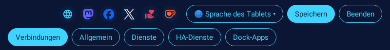

---

## 2. Mit Gladys verbinden (Tab „Verbindungen“)

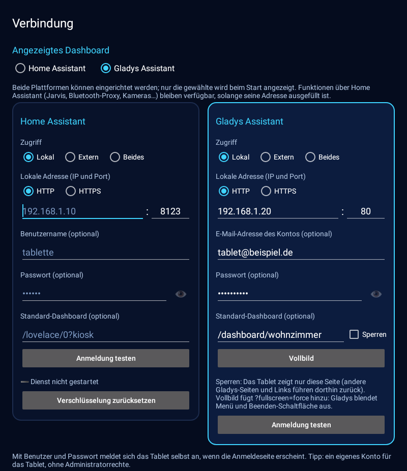

1. **Angezeigtes Dashboard**: Wähle **Gladys Assistant**. Seine Spalte wird blau umrahmt. Die Spalte Home Assistant kann leer bleiben.
2. **Zugriff**:
   - **Lokal**: Das Tablet bleibt zu Hause und erreicht Gladys über seine IP-Adresse;
   - **Extern**: nur über eine Internetadresse mit `https://` (Reverse Proxy, Tunnel…);
   - **Beides**: Die App nimmt die lokale Adresse, wenn sie antwortet, sonst die externe (ein Tablet, das das Haus verlässt).
3. **Lokale Adresse**: HTTP (oder HTTPS, wenn deine Gladys es nutzt), die **IP** von Gladys und der **Port** (standardmäßig 80).
4. **E-Mail-Adresse und Passwort** eines Gladys-Kontos: Das Tablet meldet sich selbst an, wenn die Anmeldeseite erscheint. Tipp: Lege in Gladys ein eigenes Konto für das Tablet an, ohne Administratorrechte.
5. **Standard-Dashboard** (optional): die anzuzeigende Seite, z. B. `/dashboard/wohnzimmer`: Das Feld beginnt bereits mit `/dashboard/`, es genügt, den Namen des Dashboards anzuhängen (leeren, um Gladys wählen zu lassen). Kreuzen Sie **Sperren** an, damit das Tablet nur diese Seite zeigt, und kreuzen Sie **Vollbild** an, um `?fullscreen=force` hinzuzufügen (Gladys ohne Menü und ohne Schaltfläche zum Beenden).
6. Tippe auf **Anmeldung testen**: ein ✅ pro eingerichteter Adresse. Andernfalls sagt die Meldung, woran es hakt (Server nicht erreichbar, Konto abgelehnt…).

> **Netzwerk**: Ist das Tablet in einem anderen WLAN oder VLAN als Gladys (Netz für smarte Geräte, Gäste…), muss deine Firewall ihm erlauben, Gladys zu erreichen (Port 80 oder der Port deiner Gladys) und, für Schritt 5, den MQTT-Broker (Port 1883).

---

## 3. Allgemeine Einstellungen (Tab „Allgemein“)

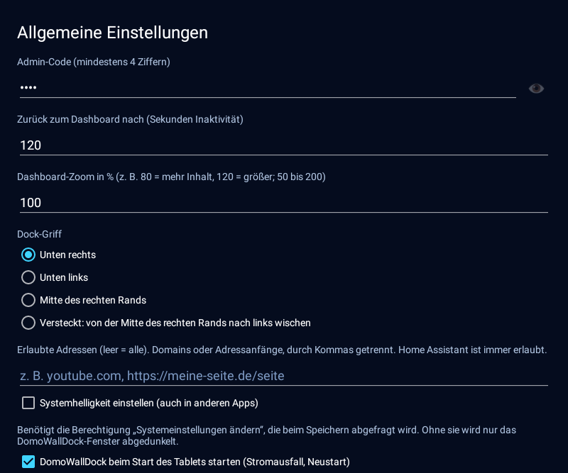

- **Admin-Code** (mindestens 4 Ziffern): Er schützt die Einstellungen.
- **Zurück zum Dashboard** nach einigen Sekunden ohne Berührung, wenn eine andere Dock-App geöffnet ist.
- **Zoom** des Dashboards, Position des **Dock-Griffs**, **erlaubte Adressen**, automatischer Start der App.

**Bildschirmschoner**: eine Uhr (oder Fotos, oder eine Gladys-Seite, siehe unten) nach einer Wartezeit ohne Berührung, in Sekunden.

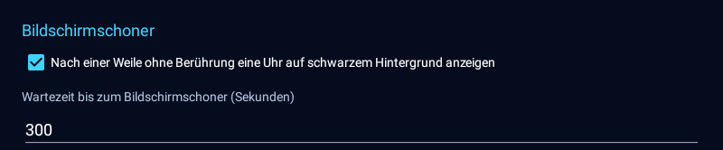

**Bildschirm jede Nacht aus**: Tippe auf eine Uhrzeit, um sie mit den Stunden- / Minutenrädern einzustellen.

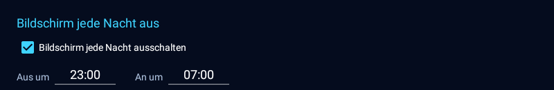

**Bewegungserkennung**: Die Frontkamera schaltet den Bildschirm ein, wenn jemand vorbeigeht, und kann ihn nach einer Wartezeit ohne Personen ausschalten (in Sekunden, 0 = nie). Die Bilder bleiben auf dem Tablet und werden nie gespeichert.

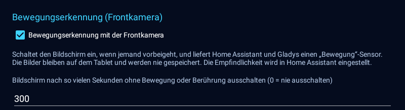

**Berechtigungen**: Für einen echten Kiosk-Modus tippe auf **DomoWallDock als Startbildschirm festlegen** und **Über anderen Apps einblenden erlauben**.

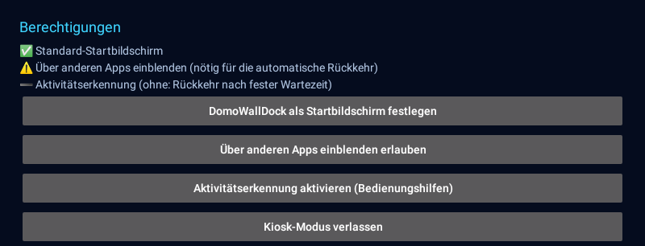

Im selben Tab: **Sicherung / Wiederherstellung** der Einstellungen in einer Datei. Die gewünschten Apps werden im Tab **Dock-Apps** angehakt.

Schalte außerdem die **Akku-Optimierung** von Android für DomoWallDock ab, sonst kann das System die App beenden ([dontkillmyapp.com](https://dontkillmyapp.com) beschreibt jede Marke).

---

## 4. Der Gladys-Kalender (Tab „Dienste“)

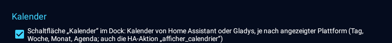

Hake **Schaltfläche „Kalender“ im Dock** an: Wenn Gladys angezeigt wird, zeigt sie die Kalender von Gladys (deine und die geteilten) als Tag, Woche, Monat oder Agenda.

---

## 5. Das Tablet in Gladys (MQTT)

Das Tablet meldet sich per MQTT selbst bei Gladys an und erscheint dort als Gerät.

**Voraussetzung**: die eingerichtete **MQTT**-Integration von Gladys (Integrationen → MQTT) mit ihrem Broker (dem von Gladys installierten oder einem vorhandenen) sowie Benutzer / Passwort.

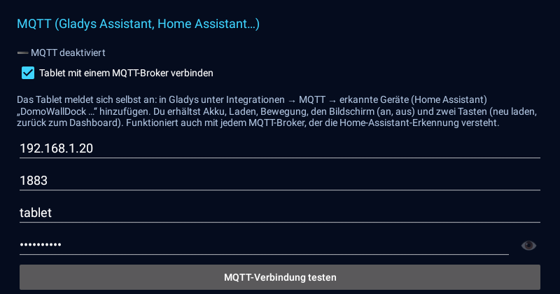

1. Im Tab **Dienste → MQTT** hake **Tablet mit einem MQTT-Broker verbinden** an.
2. Trage **Broker-Adresse**, **Port** (1883), **Benutzer** und **Passwort** ein.
3. Tippe auf **MQTT-Verbindung testen**: ✅ erwartet.
4. **Speichern**.
5. In Gladys: **Integrationen → MQTT → erkannte Geräte**, „**DomoWallDock …**“ hinzufügen.

Du erhältst in Gladys:

| Funktion | Typ |
|---|---|
| Akku (%), Akkutemperatur | Sensoren |
| Lädt, Laden gewünscht, Bewegung | Ja-/Nein-Sensoren |
| Bildschirm | Schalter (an / aus) |
| Dashboard neu laden, Zurück zum Dashboard | Tasten |

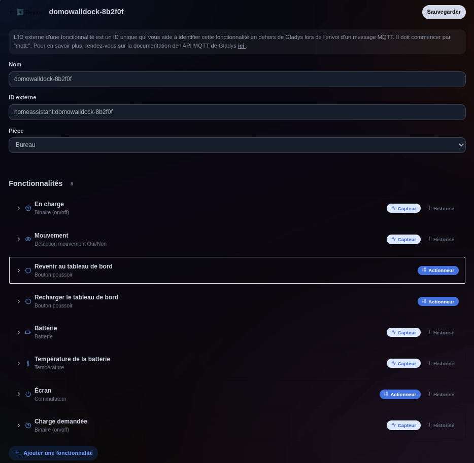

So kannst du zum Beispiel den Bildschirm einschalten, wenn jemand klingelt, oder ausschalten, wenn das Haus in den Abwesenheitsmodus wechselt.

---

## 6. Den Akku eines dauerhaft angeschlossenen Tablets schonen

Ein dauerhaft auf 100 % gehaltener Akku verschleißt und kann sich aufblähen. Android verbietet einer App, das Laden abzuschalten: DomoWallDock veröffentlicht daher einen Sensor **„Laden gewünscht“**, und Gladys steuert eine **smarte Steckdose** am Ladegerät.

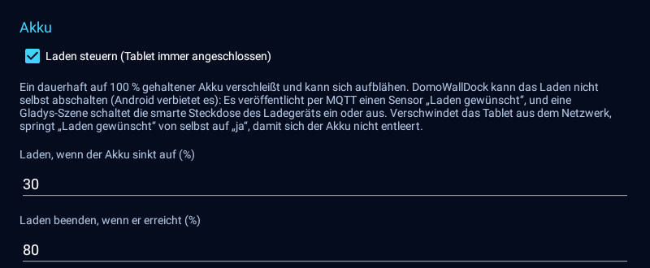

1. Stecke das Ladegerät des Tablets in eine smarte Steckdose, die Gladys bereits steuert.
2. Hake im Tab **Dienste → Akku** **Laden steuern** an (MQTT muss aktiv sein). Stelle die Schwellen ein: Laden unter 30 %, Stopp bei 80 % (Standard).
3. Lege in Gladys zwei Szenen an, die bei einer Zustandsänderung von **„Laden gewünscht“** auslösen:
   - wechselt auf **1** → Steckdose des Ladegeräts **einschalten**;
   - wechselt auf **0** → Steckdose **ausschalten**.

Verschwindet das Tablet aus dem Netzwerk (Absturz, WLAN weg), setzt der Broker „Laden gewünscht“ von selbst auf 1: Die Steckdose geht wieder an und der Akku entleert sich nicht.

---

## 7. Bildschirmschoner: Fotos oder eine Gladys-Seite

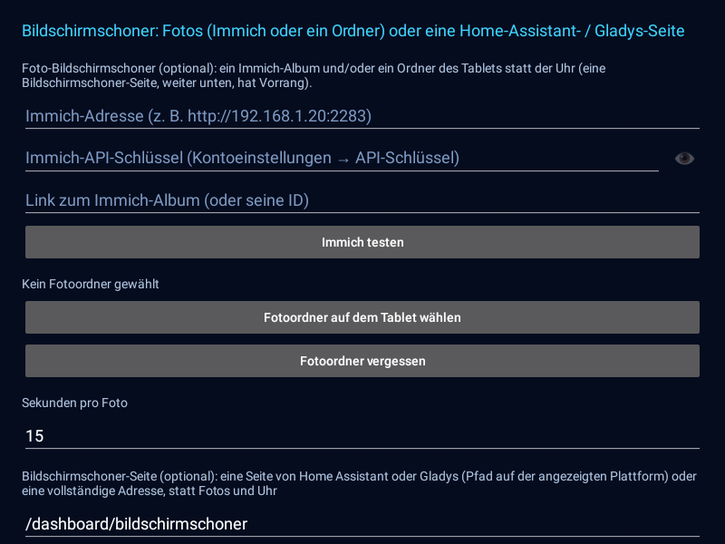

Statt der Uhr kann der Bildschirmschoner Folgendes zeigen:

- ein **[Immich](https://immich.app/)-Album**: Immich-Adresse, API-Schlüssel und Album-Link, dann **Immich testen**;
- einen **Fotoordner** des Tablets;
- eine **Gladys-Seite**, z. B. ein schlichtes Dashboard `/dashboard/bildschirmschoner` (sie hat Vorrang vor den Fotos).

---

## 8. Weitere Dienste

Wählst du Gladys, wählt die App den **Bluetooth-Proxy** und den Sprachassistenten **Jarvis** (sie laufen über Home Assistant) sowie den **Music-Assistant**-Player selbst ab (Tab **HA-Dienste**). Du kannst sie wieder anwählen: etwa wenn du auch Home Assistant nutzt oder einen Music-Assistant-Server (er funktioniert mit oder ohne Home Assistant).

---

## 9. Im Alltag

- Der Griff **▲** öffnet das Dock: deine Apps, der Kalender, die Seite **Neu laden**, **Einstellungen**.
- Antwortet Gladys nicht mehr, zeigt ein Notfallbildschirm die Uhrzeit; das Dashboard kommt von selbst zurück.
- **Update**: das neue APK über das alte installieren, die Einstellungen bleiben erhalten.
- Vor einer großen Änderung: **Einstellungen sichern…** im Tab Allgemein.
