# Guide: DomoWallDock with Gladys Assistant

  &nbsp;
  &nbsp;
  &nbsp;
  

This guide turns an Android tablet into a wall panel for [Gladys Assistant](https://gladysassistant.com/): a screen that is always ready, automatic sign-in, the tablet's sensors in Gladys and a battery that lasts.

> The addresses and accounts in the screenshots (`192.168.1.20`, `tablet@example.com`…) are examples: replace them with yours.

---

## 1. Install the app

1. Download the APK (see [Download](../README.en.md#download) in the README):
   - `DomoWallDock-x.y.z.apk` for Android 8 and newer;
   - `DomoWallDock-x.y.z-android7.apk` for an Android 7 tablet.
2. Open the file on the tablet and allow installing from this source.
3. On first start, the **settings open by themselves**.

Later, to get back to the settings: tap the small **▲** handle (bottom right by default) to open the dock, then **Settings**, and type the admin code (the OK key of the number pad confirms).

The settings are split into five tabs: **Connections**, **General**, **Services**, **HA services** and **Dock apps**. The top bar also holds the **app language** (🌐: the tablet's, or French, English, German, Spanish; the app restarts to apply it when you save), **Save** (saves without leaving) and **Quit** (closes the settings without saving).

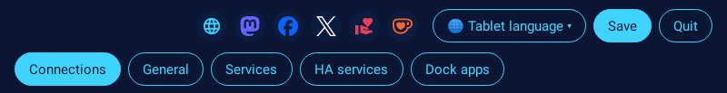

---

## 2. Connect to Gladys ("Connections" tab)

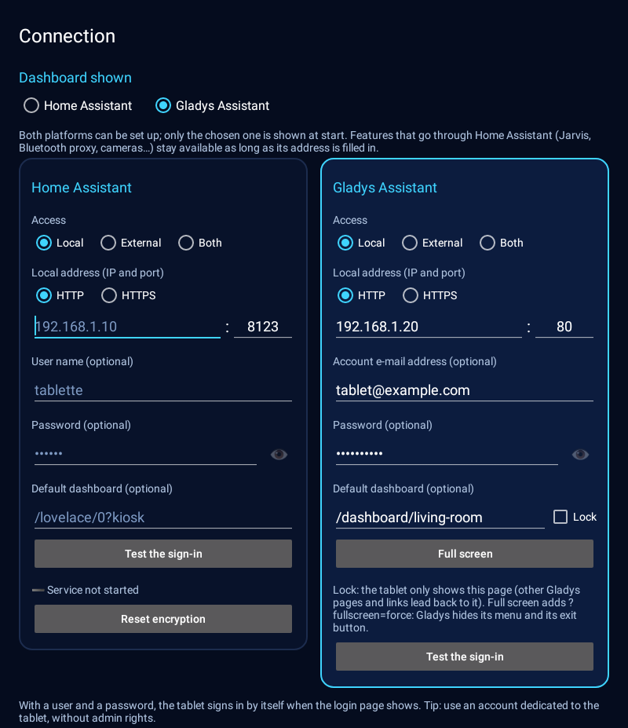

1. **Dashboard shown**: choose **Gladys Assistant**. Its column gets a blue frame. The Home Assistant column can stay empty.
2. **Access**:
   - **Local**: the tablet stays at home and reaches Gladys by its IP address;
   - **External**: only through an internet address in `https://` (reverse proxy, tunnel…);
   - **Both**: the app uses the local address when it answers, otherwise the external one (a tablet that leaves the house).
3. **Local address**: HTTP (or HTTPS if your Gladys uses it), the Gladys **IP** and the **port** (80 by default).
4. **E-mail address and password** of a Gladys account: the tablet signs in by itself when the login page shows. Tip: create a Gladys account dedicated to the tablet, without admin rights.
5. **Default dashboard** (optional): the page to show, for instance `/dashboard/living-room`. Tick **Lock** so the tablet only shows that page, and tick **Full screen** to add `?fullscreen=force` (Gladys with no menu and no exit button).
6. Tap **Test the sign-in**: one ✅ per configured address. Otherwise, the message says what is wrong (server not reachable, account refused…).

> **Network**: if the tablet is on another Wi-Fi network or VLAN than Gladys ("IoT" network, guests…), your firewall must let it reach Gladys (port 80, or your Gladys port) and, for step 5, the MQTT broker (port 1883).

---

## 3. General settings ("General" tab)

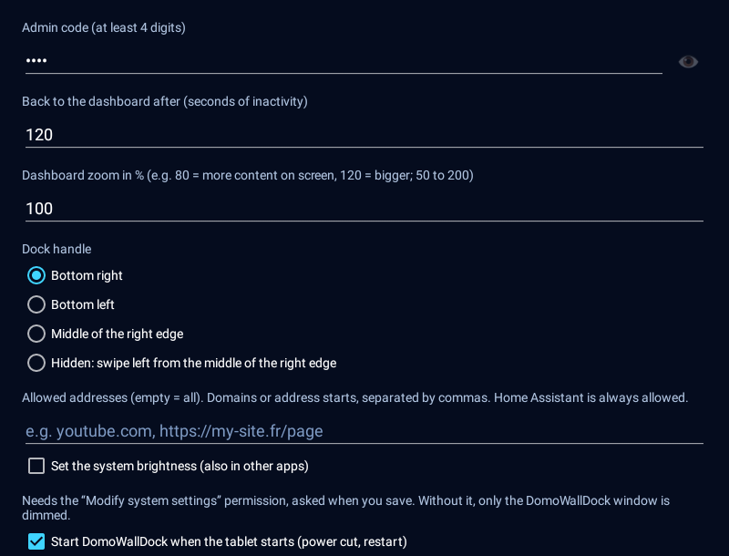

- **Admin code** (at least 4 digits): it protects the settings.
- **Back to the dashboard** after a few seconds without touching the screen, when another dock app is open.
- Dashboard **zoom**, position of the **dock handle**, **allowed addresses**, automatic start of the app.

**Screensaver**: a clock (or photos, or a Gladys page, see below) after a delay without touching the screen, in seconds.

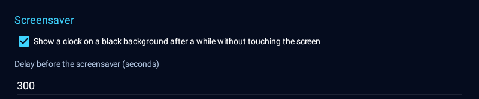

**Screen off every night**: tap a time to set it with the hour / minute wheels.

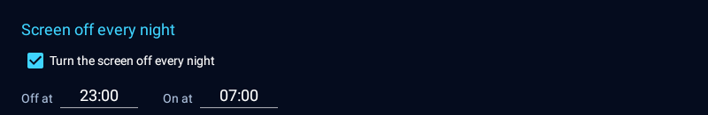

**Motion detection**: the front camera turns the screen on when someone passes, and can turn it off after a delay with nobody around (in seconds, 0 = never). Images stay on the tablet and are never recorded.

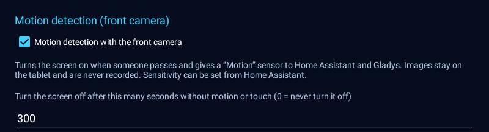

**Permissions**: for a real kiosk mode, tap **Set DomoWallDock as the home screen** and **Allow display over other apps**.

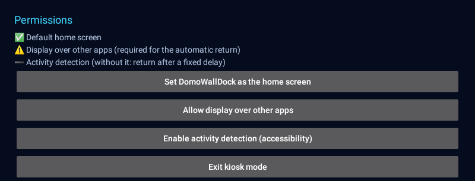

In the same tab: settings **backup / restore** to a file. The apps to keep at hand are ticked in the **Dock apps** tab.

Also turn off Android **battery optimisation** for DomoWallDock, otherwise the system may kill the app ([dontkillmyapp.com](https://dontkillmyapp.com) covers each brand).

---

## 4. The Gladys calendar ("Services" tab)

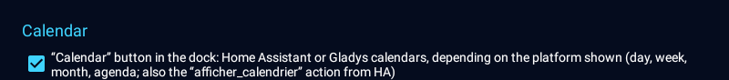

Tick **"Calendar" button in the dock**: while Gladys is shown, it displays the Gladys calendars (yours and the shared ones), as day, week, month or agenda.

---

## 5. The tablet in Gladys (MQTT)

The tablet announces itself to Gladys over MQTT and shows up there as a device.

**Prerequisite**: the Gladys **MQTT** integration set up (Integrations → MQTT), with its broker (the one Gladys installs, or an existing broker) and a user / password.

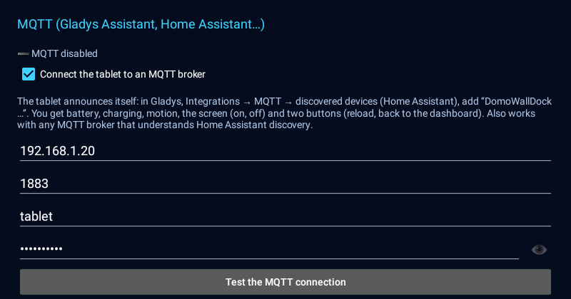

1. In the **Services → MQTT** tab, tick **Connect the tablet to an MQTT broker**.
2. Fill in the **broker address**, the **port** (1883), the **user** and the **password**.
3. Tap **Test the MQTT connection**: ✅ expected.
4. **Save**.
5. In Gladys: **Integrations → MQTT → discovered devices**, add **"DomoWallDock …"**.

You get in Gladys:

| Feature | Type |
|---|---|
| Battery (%), battery temperature | sensors |
| Charging, Charge wanted, Motion | yes / no sensors |
| Screen | switch (on / off) |
| Reload the dashboard, Back to the dashboard | buttons |

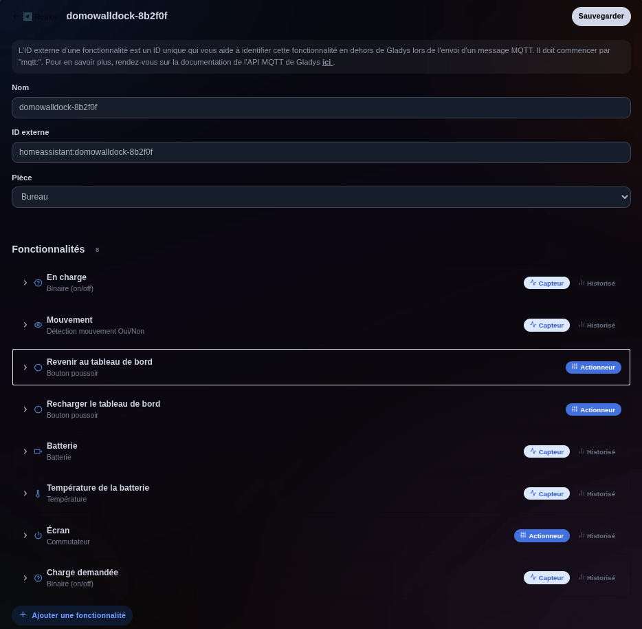

For example, you can turn the tablet screen on when someone rings, or off when the house switches to away mode.

---

## 6. Save the battery of an always-plugged tablet

A battery kept at 100 % all the time wears out and can swell. Android forbids an app to cut charging: DomoWallDock therefore publishes a **"Charge wanted"** sensor and Gladys drives a **smart plug** on the charger.

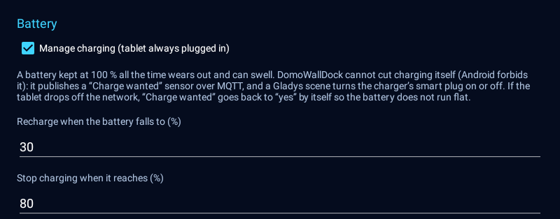

1. Plug the tablet charger into a smart plug already handled by Gladys.
2. In the **Services → Battery** tab, tick **Manage charging** (MQTT must be on). Set the thresholds: recharge below 30 %, stop at 80 % by default.
3. In Gladys, create two scenes triggered by the state change of **"Charge wanted"**:
   - goes to **1** → turn the charger plug **on**;
   - goes to **0** → turn the plug **off**.

If the tablet drops off the network (crash, Wi-Fi down), the broker sets "Charge wanted" back to 1 by itself: the plug turns back on and the battery does not run flat.

---

## 7. Screensaver: photos or a Gladys page

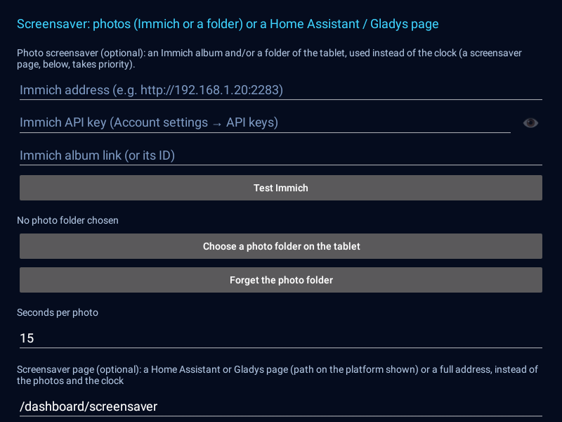

Instead of the clock, the screensaver can show:

- an **[Immich](https://immich.app/) album**: Immich address, API key and album link, then **Test Immich**;
- a **photo folder** of the tablet;
- a **Gladys page**, for instance a minimal dashboard `/dashboard/screensaver` (it takes priority over the photos).

---

## 8. Other services

When you choose Gladys, the app unticks the **Bluetooth proxy** and the **Jarvis** voice assistant (they go through Home Assistant), as well as the **Music Assistant** player (**HA services** tab). You can tick them again: for instance if you also use Home Assistant, or a Music Assistant server (it works with or without Home Assistant).

---

## 9. Every day

- The **▲** handle opens the dock: your apps, the calendar, **Reload** the page, **Settings**.
- If Gladys stops answering, a fallback screen shows the time; the dashboard comes back by itself.
- **Update**: install the new APK over the old one, the settings are kept.
- Before a big change: **Save settings…** in the General tab.
