# Guía: DomoWallDock con Gladys Assistant

  &nbsp;
  &nbsp;
  &nbsp;
  

Esta guía convierte una tableta Android en un panel de pared para [Gladys Assistant](https://gladysassistant.com/): pantalla siempre lista, inicio de sesión automático, los sensores de la tableta en Gladys y una batería cuidada.

> Las direcciones y cuentas de las capturas (`192.168.1.20`, `tableta@ejemplo.es`…) son ejemplos: sustitúyelas por las tuyas.

---

## 1. Instalar la app

1. Descarga el APK (ver [Descarga](../README.es.md#descarga) en el README):
   - `DomoWallDock-x.y.z.apk` para Android 8 o más reciente;
   - `DomoWallDock-x.y.z-android7.apk` para una tableta con Android 7.
2. Abre el archivo en la tableta y permite la instalación desde este origen.
3. En el primer inicio, **los ajustes se abren solos**.

Más tarde, para volver a los ajustes: toca la pequeña asa **▲** (abajo a la derecha por defecto) para abrir el dock, luego **Ajustes**, y escribe el código de administrador (la tecla OK del teclado numérico confirma).

Los ajustes se dividen en cinco pestañas: **Conexiones**, **Generales**, **Servicios**, **Servicios HA** y **Apps del dock**. La barra superior también ofrece el **idioma de la app** (🌐: el de la tableta, o francés, inglés, alemán, español; la app se reinicia al guardar para aplicarlo), **Guardar** (guarda sin salir) y **Salir** (cierra los ajustes sin guardar).

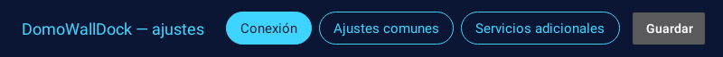

---

## 2. Conectarse a Gladys (pestaña «Conexiones»)

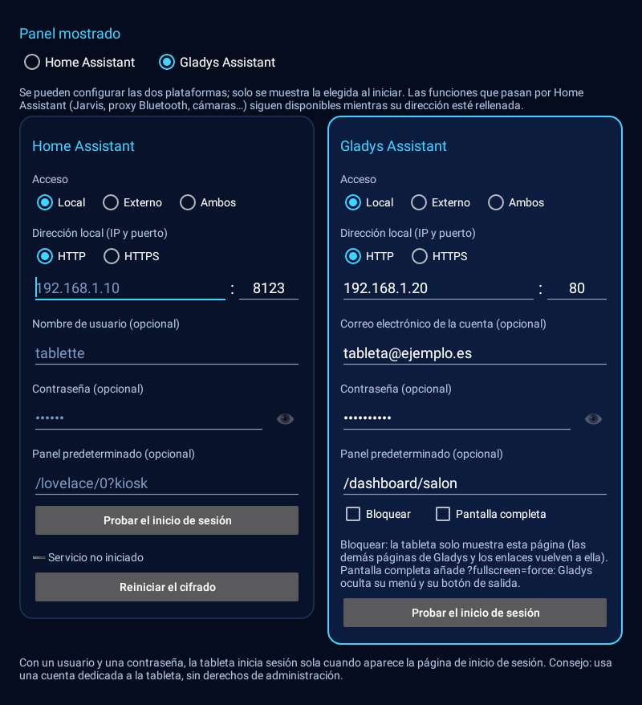

1. **Panel mostrado**: elige **Gladys Assistant**. Su columna se enmarca en azul. La columna de Home Assistant puede quedar vacía.
2. **Acceso**:
   - **Local**: la tableta se queda en casa y llega a Gladys por su dirección IP;
   - **Externo**: solo por una dirección de internet con `https://` (proxy inverso, túnel…);
   - **Ambos**: la app usa la dirección local cuando responde y, si no, la externa (una tableta que sale de casa).
3. **Dirección local**: HTTP (o HTTPS si tu Gladys lo usa), la **IP** de Gladys y el **puerto** (80 por defecto).
4. **Correo electrónico y contraseña** de una cuenta de Gladys: la tableta inicia sesión sola cuando aparece la página de inicio de sesión. Consejo: crea en Gladys una cuenta dedicada a la tableta, sin derechos de administración.
5. **Panel predeterminado** (opcional): la página que mostrar, por ejemplo `/dashboard/salon`: el campo ya empieza por `/dashboard/`, basta con añadir el nombre del panel (bórrelo para que Gladys elija). Marque **Bloquear** para que la tableta solo muestre esa página y marque **Pantalla completa** para añadir `?fullscreen=force` (Gladys sin menú ni botón de salida).
6. Toca **Probar el inicio de sesión**: un ✅ por cada dirección configurada. Si no, el mensaje dice qué falla (servidor inaccesible, cuenta rechazada…).

> **Red**: si la tableta está en otra red Wi-Fi u otra VLAN que Gladys (red de objetos conectados, invitados…), tu cortafuegos debe dejarla llegar a Gladys (puerto 80, o el de tu Gladys) y, para el paso 5, al broker MQTT (puerto 1883).

---

## 3. Ajustes generales (pestaña «Generales»)

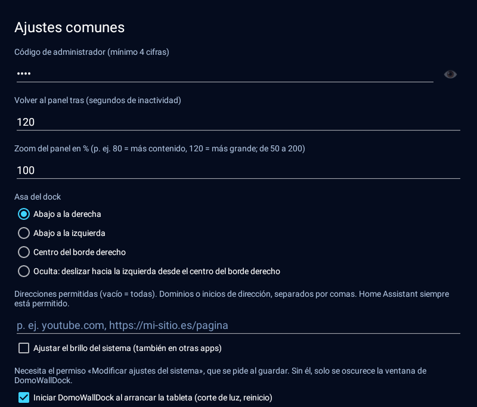

- **Código de administrador** (mínimo 4 cifras): protege los ajustes.
- **Volver al panel** tras unos segundos sin tocar la pantalla, cuando hay otra app del dock abierta.
- **Zoom** del panel, posición del **asa del dock**, **direcciones permitidas**, inicio automático de la app.

**Salvapantallas**: un reloj (o fotos, o una página de Gladys, ver más abajo) tras un tiempo sin tocar la pantalla, en segundos.

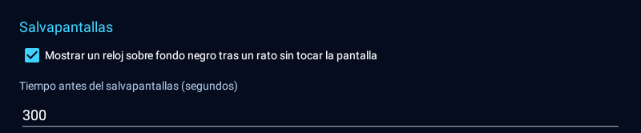

**Pantalla apagada cada noche**: toca una hora para ajustarla con las ruedas de horas / minutos.

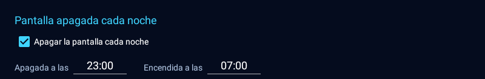

**Detección de movimiento**: la cámara frontal enciende la pantalla cuando alguien pasa y puede apagarla tras un tiempo sin nadie (en segundos, 0 = nunca). Las imágenes se quedan en la tableta y nunca se graban.

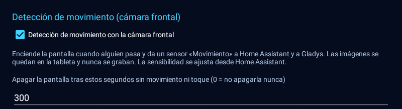

**Permisos**: para un verdadero modo quiosco, toca **Definir DomoWallDock como pantalla de inicio** y **Permitir mostrar sobre otras apps**.

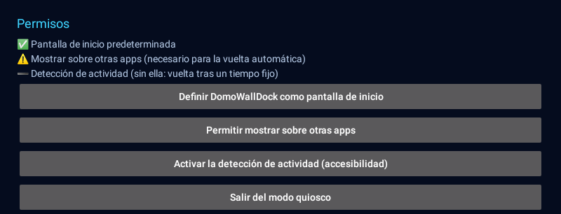

En la misma pestaña: **copia de seguridad / restauración** de los ajustes en un archivo. Las apps que quieras tener a mano se marcan en la pestaña **Apps del dock**.

Desactiva también la **optimización de batería** de Android para DomoWallDock; si no, el sistema puede cerrar la app ([dontkillmyapp.com](https://dontkillmyapp.com) detalla cada marca).

---

## 4. El calendario de Gladys (pestaña «Servicios»)

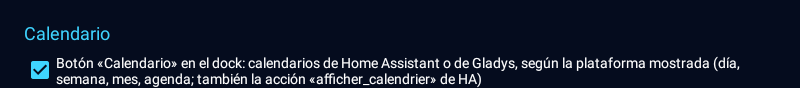

Marca **Botón «Calendario» en el dock**: cuando se muestra Gladys, enseña los calendarios de Gladys (los tuyos y los compartidos), en vista día, semana, mes o agenda.

---

## 5. La tableta en Gladys (MQTT)

La tableta se anuncia sola a Gladys por MQTT y aparece allí como un dispositivo.

**Requisito**: la integración **MQTT** de Gladys configurada (Integraciones → MQTT), con su broker (el que instala Gladys o uno existente) y un usuario / contraseña.

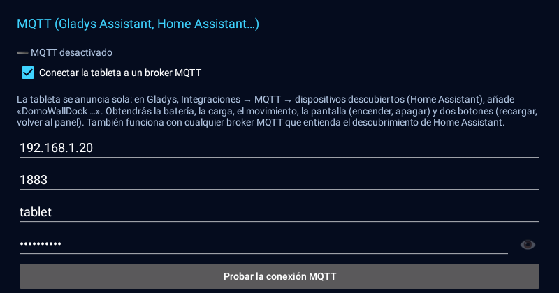

1. En la pestaña **Servicios → MQTT**, marca **Conectar la tableta a un broker MQTT**.
2. Rellena la **dirección del broker**, el **puerto** (1883), el **usuario** y la **contraseña**.
3. Toca **Probar la conexión MQTT**: se espera ✅.
4. **Guardar**.
5. En Gladys: **Integraciones → MQTT → dispositivos descubiertos**, añade **«DomoWallDock …»**.

Obtienes en Gladys:

| Función | Tipo |
|---|---|
| Batería (%), temperatura de la batería | sensores |
| Cargando, Carga solicitada, Movimiento | sensores sí / no |
| Pantalla | interruptor (encender / apagar) |
| Recargar el panel, Volver al panel | botones |

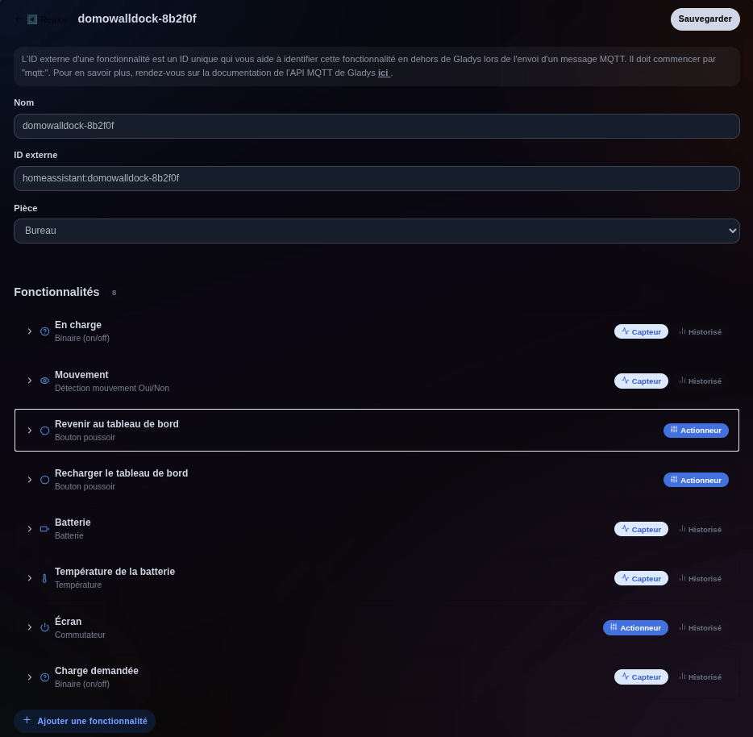

Por ejemplo, puedes encender la pantalla de la tableta cuando alguien llama al timbre, o apagarla cuando la casa pasa a modo ausente.

---

## 6. Cuidar la batería de una tableta siempre enchufada

Una batería mantenida al 100 % todo el tiempo se desgasta y puede hincharse. Android prohíbe a una app cortar la carga: por eso DomoWallDock publica un sensor **«Carga solicitada»** y Gladys controla un **enchufe inteligente** en el cargador.

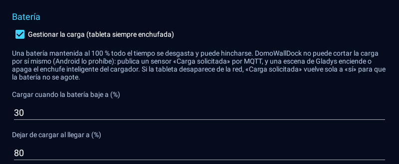

1. Enchufa el cargador de la tableta en un enchufe inteligente ya gestionado por Gladys.
2. En la pestaña **Servicios → Batería**, marca **Gestionar la carga** (MQTT debe estar activo). Ajusta los umbrales: carga por debajo del 30 %, parada al 80 % por defecto.
3. En Gladys, crea dos escenas que se activen con el cambio de estado de **«Carga solicitada»**:
   - pasa a **1** → **encender** el enchufe del cargador;
   - pasa a **0** → **apagar** el enchufe.

Si la tableta desaparece de la red (cuelgue, Wi-Fi caído), el broker vuelve a poner sola «Carga solicitada» a 1: el enchufe se enciende de nuevo y la batería no se agota.

---

## 7. Salvapantallas: fotos o una página de Gladys

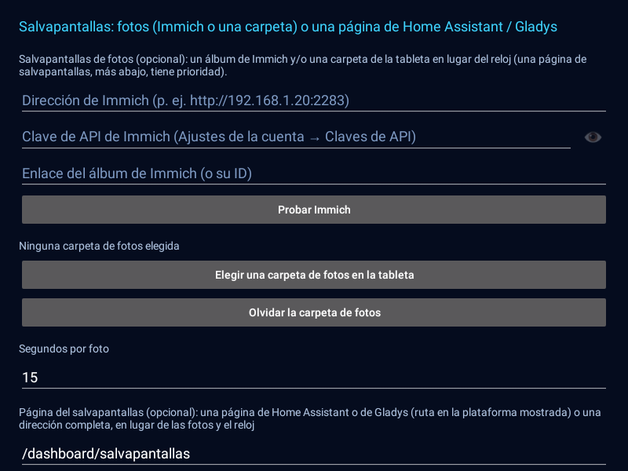

En lugar del reloj, el salvapantallas puede mostrar:

- un **álbum de [Immich](https://immich.app/)**: dirección de Immich, clave de API y enlace del álbum, luego **Probar Immich**;
- una **carpeta de fotos** de la tableta;
- una **página de Gladys**, por ejemplo un panel sencillo `/dashboard/salvapantallas` (tiene prioridad sobre las fotos).

---

## 8. Los demás servicios

Cuando eliges Gladys, la app desmarca sola el **proxy Bluetooth** y el asistente de voz **Jarvis** (pasan por Home Assistant), así como el reproductor de **Music Assistant** (pestaña **Servicios HA**). Puedes volver a marcarlos: por ejemplo si también usas Home Assistant, o un servidor Music Assistant (funciona con o sin Home Assistant).

---

## 9. En el día a día

- El asa **▲** abre el dock: tus apps, el calendario, **Recargar** la página, **Ajustes**.
- Si Gladys deja de responder, una pantalla de emergencia muestra la hora; el panel vuelve solo.
- **Actualización**: instala el nuevo APK encima del anterior, se conservan los ajustes.
- Antes de un cambio importante: **Guardar los ajustes…** en la pestaña Generales.
