# Tutoriel : DomoWallDock avec Gladys Assistant

  &nbsp;
  &nbsp;
  &nbsp;
  

Ce guide transforme une tablette Android en tableau de bord mural pour [Gladys Assistant](https://gladysassistant.com/) : écran toujours prêt, connexion automatique, capteurs de la tablette dans Gladys et batterie préservée.

> Les adresses et comptes des captures (`192.168.1.20`, `tablette@exemple.fr`…) sont des exemples : remplacez-les par les vôtres.

---

## 1. Installer l'appli

1. Téléchargez l'APK (voir [Téléchargement](../README.md#téléchargement) dans le README) :
   - `DomoWallDock-x.y.z.apk` pour Android 8 et plus ;
   - `DomoWallDock-x.y.z-android7.apk` pour une tablette Android 7.
2. Ouvrez le fichier sur la tablette et autorisez l'installation depuis cette source.
3. Au premier lancement, les **réglages s'ouvrent tout seuls**.

Plus tard, pour revenir aux réglages : touchez la petite poignée **▲** (en bas à droite par défaut) pour ouvrir le dock, puis **Réglages**, et tapez le code administrateur (la touche OK du pavé numérique valide).

Les réglages sont rangés en cinq onglets : **Connexions**, **Généraux**, **Services**, **Services HA** et **Applis Dock**. La barre du haut donne aussi le choix de la **langue de l'appli** (🌐 : celle de la tablette, ou français, anglais, allemand, espagnol ; l'appli redémarre pour l'appliquer à l'enregistrement), **Enregistrer** (enregistre sans quitter) et **Quitter** (ferme les réglages sans enregistrer).

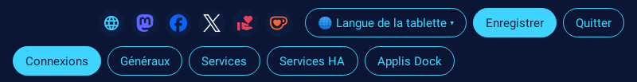

---

## 2. Se connecter à Gladys (onglet « Connexions »)

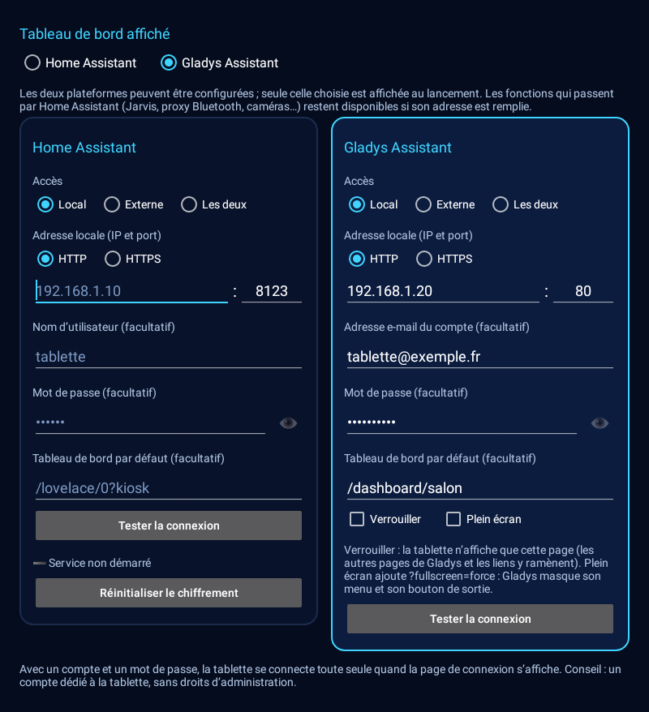

1. **Tableau de bord affiché** : choisissez **Gladys Assistant**. Sa colonne s'encadre en bleu. La colonne Home Assistant peut rester vide.
2. **Accès** :
   - **Local** : la tablette reste à la maison, elle joint Gladys par son adresse IP ;
   - **Externe** : uniquement par une adresse internet en `https://` (reverse proxy, tunnel…) ;
   - **Les deux** : l'appli prend l'adresse locale quand elle répond, sinon l'externe (tablette qui sort de la maison).
3. **Adresse locale** : HTTP (ou HTTPS si votre Gladys l'utilise), l'**IP** de Gladys et le **port** (80 par défaut).
4. **Adresse e-mail et mot de passe** d'un compte Gladys : la tablette se connecte toute seule quand la page de connexion s'affiche. Conseil : créez dans Gladys un compte dédié à la tablette, sans droits d'administration.
5. **Tableau de bord par défaut** (facultatif) : la page à afficher, par exemple `/dashboard/salon`. Cochez **Verrouiller** pour que la tablette n'affiche que cette page, et cochez **Plein écran** pour ajouter `?fullscreen=force` (Gladys sans menu ni bouton de sortie).
6. Touchez **Tester la connexion** : un ✅ par adresse configurée. Sinon, le message dit ce qui bloque (serveur injoignable, compte refusé…).

> **Réseau** : si la tablette est sur un autre réseau Wi-Fi ou un autre VLAN que Gladys (réseau « objets connectés », invités…), votre pare-feu doit la laisser joindre Gladys (port 80, ou celui de votre Gladys) et, pour l'étape 5, le broker MQTT (port 1883).

---

## 3. Réglages généraux (onglet « Généraux »)

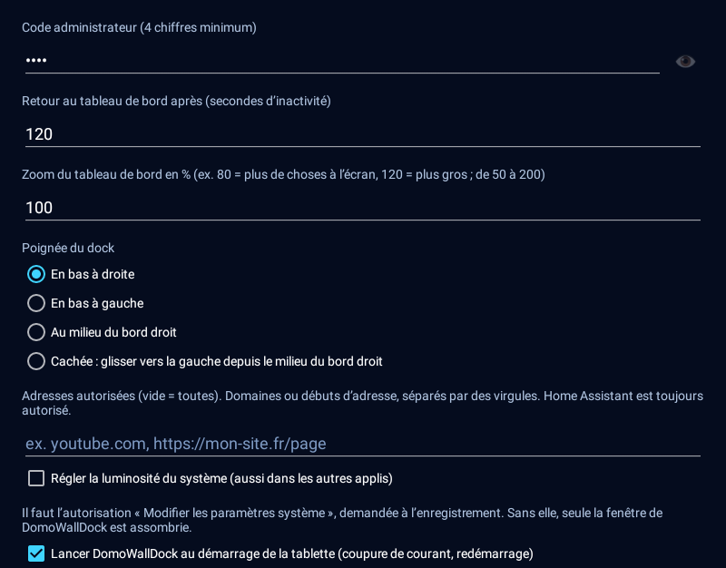

- **Code administrateur** (4 chiffres minimum) : il protège les réglages.
- **Retour au tableau de bord** après quelques secondes sans toucher l'écran, quand une autre appli du dock est ouverte.
- **Zoom** du tableau de bord, position de la **poignée du dock**, **adresses autorisées**, démarrage automatique de l'appli.

**Écran de veille** : une horloge (ou des photos, ou une page Gladys, voir plus bas) après un délai sans toucher l'écran, en secondes.

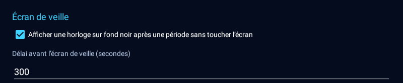

**Écran éteint chaque nuit** : touchez une heure pour la régler avec les roues heures / minutes.

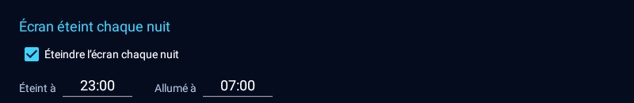

**Détection de mouvement** : la caméra frontale allume l'écran quand quelqu'un passe, et peut l'éteindre après un délai sans personne (en secondes, 0 = jamais). Les images restent sur la tablette et ne sont jamais enregistrées.

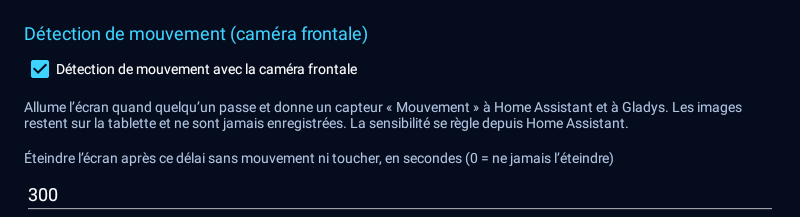

**Autorisations** : pour un vrai mode kiosque, touchez **Définir DomoWallDock comme écran d'accueil** et **Autoriser l'affichage par-dessus les autres applis**.

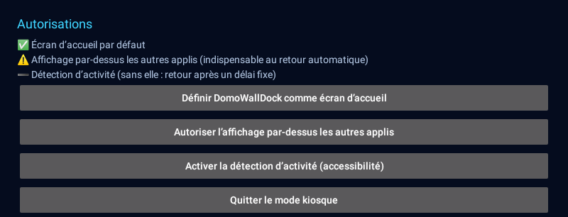

Dans le même onglet : **sauvegarde / restauration** des réglages dans un fichier. Les applis à garder sous la main se cochent dans l'onglet **Applis Dock**.

Pensez aussi à désactiver l'**optimisation de batterie** d'Android pour DomoWallDock, sinon le système peut couper l'appli ([dontkillmyapp.com](https://dontkillmyapp.com) détaille chaque marque).

---

## 4. Le calendrier de Gladys (onglet « Services »)

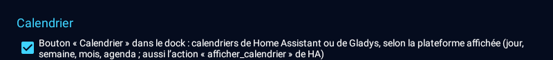

Cochez **Bouton « Calendrier » dans le dock** : quand Gladys est affiché, il montre les calendriers de Gladys (les vôtres et ceux partagés), en vue jour, semaine, mois ou agenda.

---

## 5. La tablette dans Gladys (MQTT)

La tablette s'annonce toute seule à Gladys par MQTT et y apparaît comme un appareil.

**Prérequis** : l'intégration **MQTT** de Gladys configurée (Intégrations → MQTT), avec son broker (celui que Gladys installe, ou un broker existant) et un utilisateur / mot de passe.

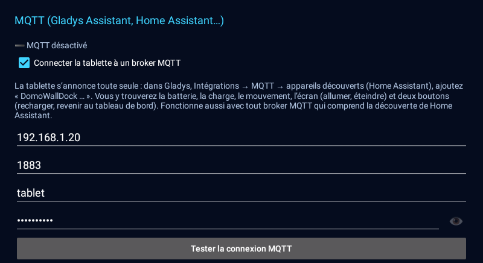

1. Dans l'onglet **Services → MQTT**, cochez **Connecter la tablette à un broker MQTT**.
2. Renseignez l'**adresse du broker**, le **port** (1883), l'**utilisateur** et le **mot de passe**.
3. Touchez **Tester la connexion MQTT** : ✅ attendu.
4. **Enregistrer**.
5. Dans Gladys : **Intégrations → MQTT → appareils découverts**, ajoutez **« DomoWallDock … »**.

Vous obtenez dans Gladys :

| Fonction | Type |
|---|---|
| Batterie (%), température de la batterie | capteurs |
| En charge, Charge demandée, Mouvement | capteurs oui / non |
| Écran | interrupteur (allumer / éteindre) |
| Recharger, Retour au tableau de bord | boutons |

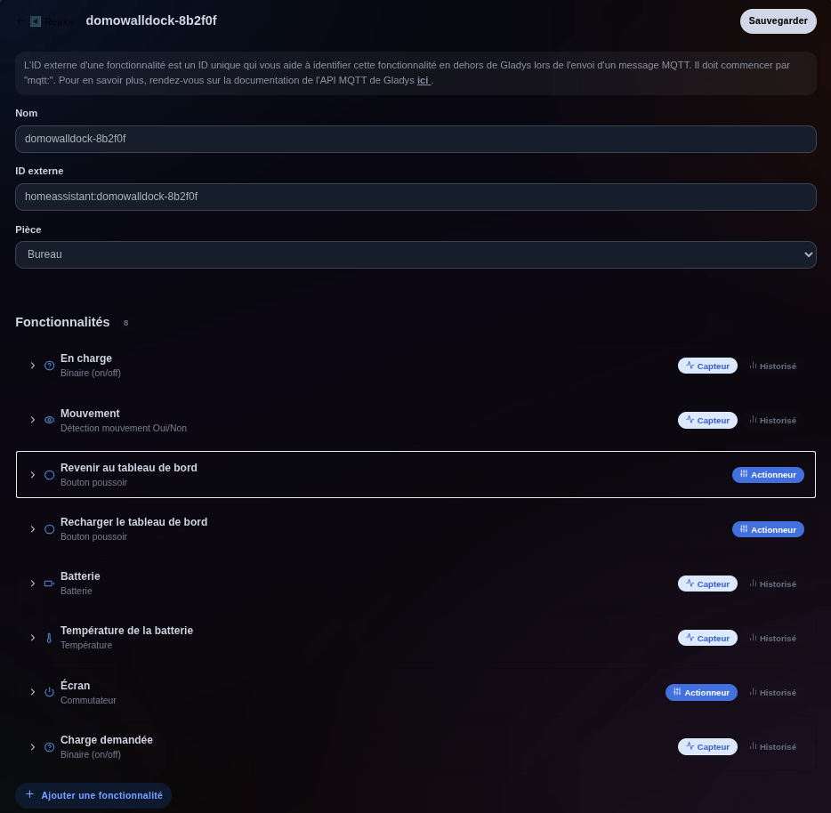

Vous pouvez par exemple allumer l'écran de la tablette quand quelqu'un sonne, ou l'éteindre quand la maison passe en mode absent.

---

## 6. Préserver la batterie d'une tablette toujours branchée

Une batterie gardée à 100 % en permanence s'abîme et peut gonfler. Android interdit à une appli de couper la charge : DomoWallDock publie donc un capteur **« Charge demandée »** et Gladys pilote une **prise connectée** sur le chargeur.

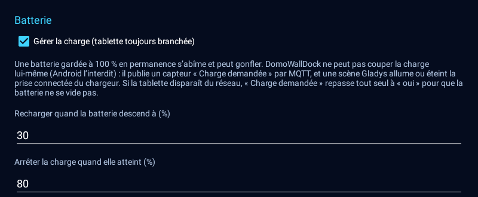

1. Branchez le chargeur de la tablette sur une prise connectée déjà gérée par Gladys.
2. Dans l'onglet **Services → Batterie**, cochez **Gérer la charge** (MQTT doit être actif). Réglez les seuils : recharge sous 30 %, arrêt à 80 % par défaut.
3. Dans Gladys, créez deux scènes déclenchées par le changement d'état de **« Charge demandée »** :
   - passe à **1** → **allumer** la prise du chargeur ;
   - passe à **0** → **éteindre** la prise.

Si la tablette disparaît du réseau (plantage, Wi-Fi coupé), le broker remet tout seul « Charge demandée » à 1 : la prise se rallume et la batterie ne se vide pas.

---

## 7. Écran de veille : photos ou page Gladys

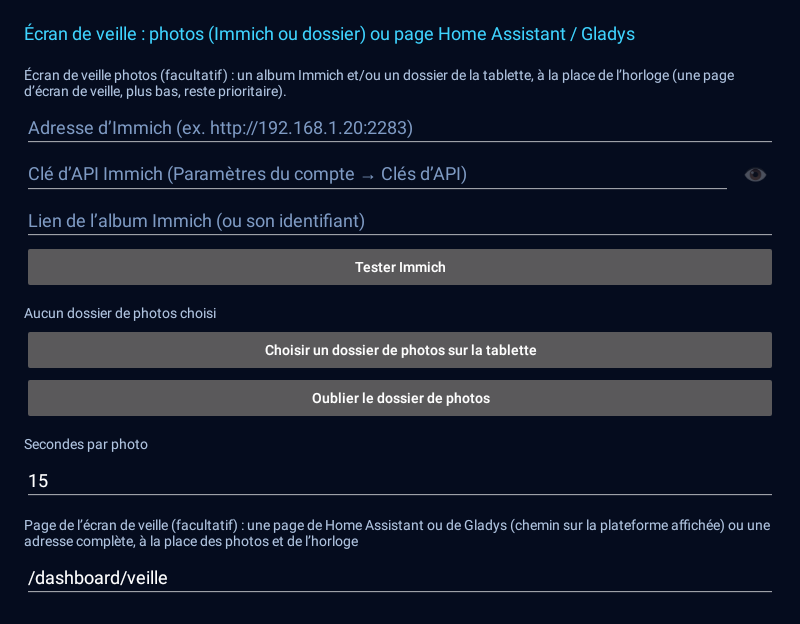

Au lieu de l'horloge, l'écran de veille peut afficher :

- un **album [Immich](https://immich.app/)** : adresse d'Immich, clé d'API et lien de l'album, puis **Tester Immich** ;
- un **dossier de photos** de la tablette ;
- une **page de Gladys**, par exemple un tableau de bord épuré `/dashboard/veille` (elle passe avant les photos).

---

## 8. Les autres services

Quand vous choisissez Gladys, l'appli décoche d'elle-même le **proxy Bluetooth** et l'assistant vocal **Jarvis** (ils passent par Home Assistant), ainsi que le lecteur **Music Assistant** (onglet **Services HA**). Vous pouvez les recocher : par exemple si vous utilisez aussi Home Assistant, ou un serveur Music Assistant (il fonctionne avec ou sans Home Assistant).

---

## 9. Au quotidien

- La poignée **▲** ouvre le dock : vos applis, le calendrier, **Recharger** la page, **Réglages**.
- Si Gladys ne répond plus, un écran de secours affiche l'heure ; le tableau de bord revient tout seul.
- **Mise à jour** : installez le nouvel APK par-dessus l'ancien, les réglages sont conservés.
- Avant un gros changement : **Sauvegarder les réglages…** dans l'onglet Généraux.
